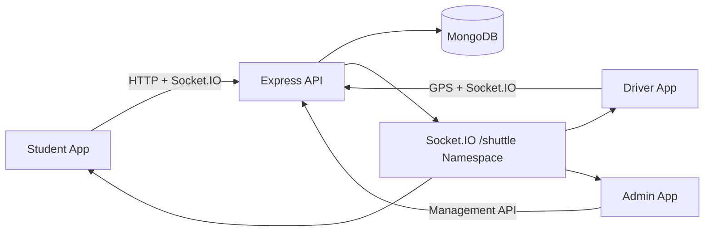

# Campus Shuttle Tracking System

<p align="center">
  
  
  
  
</p>

A real-time campus shuttle tracking and virtual queueing system for students, drivers, and administrators. The platform helps students see shuttle locations, estimate arrival times, reserve seats, and receive alerts while drivers manage active trips and boarding in real time.

## Live Demo

Visit the deployed app here: https://campus-shuttle-tracking-system.onrender.com

## Overview

This project was designed for a campus transportation context where students often wait uncertainly at stops, drivers need live route awareness, and administrators need visibility into route, shuttle, and trip operations.

The application combines:

- A Vue 3 frontend for students, drivers, and admins
- An Express + MongoDB backend
- Real-time Socket.IO communication for GPS and status updates
- Role-based authentication and access control
- Live occupancy tracking and waitlisting
- Pre-booking and scheduled reservations
- Route-based ETA estimation using stored road segments and GPS motion

## Problem It Solves

- Students are unsure when the next shuttle will arrive
- Boarding decisions are made without live vehicle visibility
- Capacity overload can occur at busy campus stops
- Drivers need a clear trip workflow, occupancy view, and boarding confirmation flow
- Admins need tools to manage routes, schedules, shuttles, and trips

## Features

### Student experience
- View active route and shuttle status
- See live shuttle markers on a campus map
- Check occupancy and ETA information
- Reserve a seat or join a waitlist
- Receive boarding confirmation and proximity alerts
- Pre-book for scheduled departures

### Driver experience
- Start and end trips
- Stream GPS updates while driving
- Confirm passenger boarding using a code-based flow
- View trip manifest and occupancy
- Resume a trip after refresh or reconnect

### Admin experience
- Manage shuttles and drivers
- Create routes with ordered stops
- Manage schedules and trip activity
- Broadcast system alerts to connected clients
- Override or end active trips when needed

## Architecture



### Tech stack
- Frontend: Vue 3, Vite, Pinia, Vue Router, Axios, Leaflet
- Backend: Node.js, Express, Mongoose, JWT
- Realtime: Socket.IO
- Data: MongoDB
- Notifications: Web Push + VAPID, custom notification flow

## Repository structure

```text
campus_shuttle_tracking_system/
├── abu-shuttle-backend/
│   ├── config/
│   ├── controllers/
│   ├── middleware/
│   ├── models/
│   ├── routes/
│   ├── services/
│   ├── socket/
│   ├── tests/
│   ├── utils/
│   ├── package.json
│   ├── server.js
│   ├── seed.js
│   └── .env
├── campus-shuttle-frontend/
│   ├── src/
│   ├── public/
│   ├── package.json
│   └── vite.config.js
├── docs/
│   ├── Context.md
│   ├── AGENTS.md
│   └── ...
├── render.yaml
├── .gitignore
├── README.md
└── ...
```

## Prerequisites

Before starting the project, make sure you have:

- Node.js 18+
- MongoDB running locally or accessible via MongoDB Atlas
- A package manager such as npm
- A browser with modern JavaScript support

## Local setup

### 1. Clone the repository

```bash
git clone <your-repo-url>
cd campus_shuttle_tracking_system
```

### 2. Configure environment variables

Create `.env` files locally for the backend and frontend if they are not already present. Keep them out of version control.

Backend example values:

```env
MONGODB_URI=mongodb://localhost:27017/campus-shuttle
JWT_SECRET=your_secret_key
ALLOWED_ORIGINS=http://127.0.0.1:3000,http://localhost:3000
PORT=5000
```

Frontend example values:

```env
VITE_BACKEND_BASE_URL=http://127.0.0.1:5000/api/v1
VITE_SOCKET_BASE_URL=http://127.0.0.1:5000
```

> The local environment files are ignored by Git to keep secrets out of source control.

### 3. Install dependencies

```bash
cd abu-shuttle-backend
npm install

cd ../campus-shuttle-frontend
npm install
```

### 4. Start the application

Backend:

```bash
cd abu-shuttle-backend
npm run dev
```

Frontend:

```bash
cd campus-shuttle-frontend
npm run dev -- --host 127.0.0.1
```

Then open:

- Frontend: http://127.0.0.1:3000
- Backend API: http://127.0.0.1:5000

## Seeded demo accounts

For local development, the project includes seeded demo accounts in the backend:

- Admin: `admin@abu.edu.ng` / `admin123`
- Driver: `driver@abu.edu.ng` / `driver123`
- Student: `student@abu.edu.ng` / `student123`
- Student 2: `student2@abu.edu.ng` / `student123`

> These are demo credentials for development and testing only. Do not use them in production.

## Available scripts

### Backend

```bash
npm run dev
npm start
npm run seed
npm run test:prepare
npm run test:regression
npm run test:load
npm run vapid
```

### Frontend

```bash
npm run dev
npm run build
npm run preview
```

## Testing and validation

The project includes local regression and load checks to validate key behavior:

- seat race handling
- waitlist promotion
- wrong-driver rejection
- scheduled booking confirmation
- route occupancy updates
- socket delivery under load

Run them with:

```bash
cd abu-shuttle-backend
npm run test:regression
npm run test:load
```

## Deployment notes

The project includes Render configuration for deployment:

- Backend deploys as a Node web service
- Frontend deploys as a static site
- Environment variables must be set in the cloud platform
- The backend must allow the frontend origin in its CORS configuration

## License

This project is licensed under the ISC License.

## Acknowledgements

This project was developed to demonstrate a full-stack real-time transit management system for campus mobility and scheduling.

## Contribution

Contributions are welcome. If you want to improve the project, open a pull request with a clear summary of the change and validation steps.
